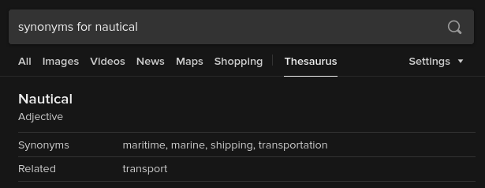

# Maritime
Welcome to maritime! This is the new low-level stack that runs on the microcontroller.

Maritime interfaces with servos, thrusters, and some sensors, and communicates with the high-level codebase, thalassic, over USB.

## Install

In a terminal, enter the following commands (do not clone the repo, the installer will do that):
```sh
curl -sSL https://raw.githubusercontent.com/avbotz/maritime/refs/heads/main/install.sh | bash
```

## Compiling

```sh
source ./setup.sh   (init terminal)
west build -b BOARD (local compile)
./comms.sh          (init serial communication)
west flash -r uf2   (flashes microcontroller)
```

Debugging build:
```sh
west build -b BOARD -- -DEXTRA_CONF_FILE=debug.conf
```

For the Raspberry Pi Pico target, use:

```sh
west build -b rpi_pico
west flash -r uf2
```

## Startup

After building and flashing, run tmux in a terminal. Split the tmux window into two panes. Run "cat < /dev/ttyACM*" in one and "cat > /dev/ttyACM*" in the other. The former pane is the DISPLAY pane, it will show the output from maritime. The latter is the COMMAND pane, it is where maritime receives its input.

You may also use screen, microcom, picocom, or any other software terminal emulator to interact with maritime, though your mileage may vary.

## Commands

The text protocol maritime uses, delimited by newlines:

Send to maritime:
```
m <t0> ... <t7>           Set all eight thrusters at once (between -1 and 1).
p <thruster_id> <thrust>  Set one thruster (thruster_id between 0 and 7, thrust between -1 and 1).
a <thrust>                Set all 8 thrusters to the same thrust.
t <id> <0|1>              Close/open torpedo id (0 or 1).
d <id> <0|1>              Close/open dropper id (0 or 1).
s <g|t|d> <pulse_us>      Raw servo pulse for the grabber, shooter or dropper.
r                         Reboot the microcontroller into DFU mode (allowing code to be flashed via UF2).
```

Send from maritime to high-level:
```
x <killed>                         5 Hz; 1 means killed, 0 means alive.
d <depth>                          5 Hz; depth in meters below the surface reading. Not sent if the pressure sensor cannot be read.
h <protocol> <uptime_ms> <stops>   5 Hz heartbeat: the protocol version, ms since boot (a drop means the board restarted), and how many times the command watchdog has stopped the thrusters.
```

Look at the overlay files for information on pin mappings.

## Internal Workings

Maritime currently communicates with the high-level stack via USB CDC-ACM, which exposes a serial interface to the computer over USB (COM ports on windows, /dev/ttyACM on Linux).

## What's the name?


## Why maritime?
Maritime was designed from the ground up to solve many deficiencies with the current Nautical system. These include:
* Limited computing power on the Atmega 2560 (clock, flash/ram, no FPU)
* Constrained to AVR devices only
* No threading capabilities
* Lack of a robust communication protocol between microcontroller and PC

Maritime addresses the above deficiences as well as makes further improvements:
* Switched hardware from Arduino Mega2560 to RP2040 based boards
* Uses Zephyr RTOS (for hardware abstraction as well as multithreading)
Planned:
* Ethernet rather than USB for communication between maritime and the PC
* MAVLink communication protocol between maritime and the PC
* Migration to Flipsky ESCS and CAN-FD for communication
